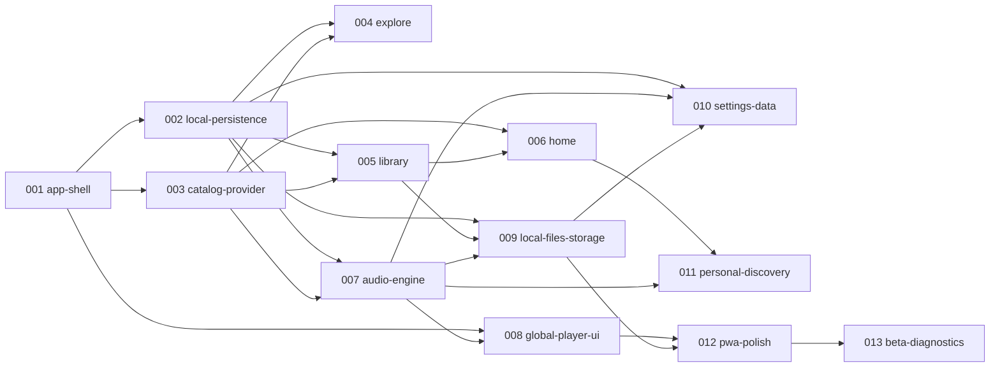

# Feature Specification Index

> **Status:** Approved index · **Created:** 2026-11-05
> **Owns:** the list of Spec Kit features, their order, the feature IDs each one covers, and the dependencies between them.
> **Supersedes:** the "Proposed Spec Kit feature breakdown" in [docs/roadmap.md](../docs/roadmap.md) (owner decision, 2026-11-05).
> **Related:** feature IDs and priorities in [product-requirements.md §5](../docs/product-requirements.md#5-features-and-priorities) · phases in [roadmap.md](../docs/roadmap.md) · principles in [constitution](../.specify/memory/constitution.md) · gates in [quality-gates.md](../docs/quality-gates.md)

Each feature gets its own directory, `specs/NNN-name/`, created with `/speckit-specify` **only when it is next in line**. Do not write specs or plans ahead of time. Numbers are sequential and follow the implementation order below.

## 1. Index

| # | Feature | Phase | Covers (feature IDs) | Depends on | Spec status |
|---|---|---|---|---|---|
| 001 | `001-app-shell` — App shell & navigation | 01 | SHELL-01, SHELL-02, SHELL-05, SET-01, SET-02 (switching and persistence only), PLAT-02 (baseline); D5 display name | — | **Approved 2026-11-05**; plan approved 2026-11-05 (G3 passed); tasks not started |
| 002 | `002-local-persistence` — Local persistence foundation | 02 | PLAT-01 (library and settings storage; private-mode fallback) | 001 | Not started |
| 003 | `003-catalog-provider` — Mock catalog & provider registry | 02 | SRC-01 (+ registry and the provider contract suite) | 001 | Not started |
| 004 | `004-explore` — Explore | 02 | EXP-01, EXP-02, EXP-03, EXP-04, EXP-05, EXP-06, EXP-07, EXP-08 | 002, 003 | Not started |
| 005 | `005-library` — Library | 02 | LIB-01, LIB-02, LIB-03, LIB-04, LIB-05, LIB-06, LIB-07, LIB-08, LIB-09 | 002, 003 | Not started |
| 006 | `006-home` — Home (mock-driven rules) | 02 | HOME-01, HOME-02, HOME-04, HOME-05ᵃ, HOME-06ᵃ, HOME-07ᵃ | 003, 005 | Not started |
| 007 | `007-audio-engine` — Audio engine, queue & playback control | 03 | NP-12, PLAT-01ᵇ (player snapshot); queue domain; play-event recording | 002, 003 | Not started |
| 008 | `008-global-player-ui` — Global player UI | 03 | NP-01, NP-02, NP-03, NP-04, NP-05, NP-06, NP-07, NP-08, NP-09, NP-10, NP-13, SHELL-04ᶜ (shortcuts), HOME-03; "Skip to player" link (deferred from 001) | 001, 007 | Not started |
| 009 | `009-local-files-storage` — Local files, sample audio & storage | 03 | SRC-02, SRC-03, LIB-10, SET-07, PLAT-06 | 002, 005, 007 | Not started |
| 010 | `010-settings-data` — Settings: playback, data & About | 02–03 | SET-03, SET-04, SET-05; restrict `/settings/<section>` (O7) | 002, 007, 009 | Not started |
| 011 | `011-personal-discovery` — Personal discovery | 04 | HOME-05ᵃ, HOME-06ᵃ, HOME-07ᵃ (history rules), HOME-08, HOME-09, EXP-09 | 006, 007 | Not started |
| 012 | `012-pwa-polish` — PWA, offline & polish | 05 | PLAT-03, PLAT-04, NP-04ᵈ (refinement), NP-11, NP-14, NP-15, SHELL-03, SHELL-04ᶜ (help dialog), LIB-11, LIB-12, SET-06 | 008, 009 | Not started |
| 013 | `013-beta-diagnostics` — Beta & diagnostics | 06 | PLAT-05 (+ beta onboarding, bug-report page) | 012 | Not started |

**Intentional splits.** A few IDs appear in two features because the approved roadmap delivers them in stages:
- ᵃ HOME-05/06/07 ship first with mock rules (006, Phase 02). The history-based rules arrive in 011 (Phase 04).
- ᵇ PLAT-01 is split between the library and settings stores (002) and the player snapshot (007).
- ᶜ SHELL-04 shortcuts are P0 (008). The help dialog is P1 (012).
- ᵈ NP-04 is delivered in 008. 012 refines it.

**Unscheduled (P2):** SRC-04, EXP-10, LIB-13, NP-16, NP-17, plus sync, a backend and Android. These are not specified until the owner records a decision after Phase 06.

## 2. Dependency map

**Why this order (changes to the proposed 9-feature list):**
- **Local Persistence moves up to 002.** Explore (recent searches), Library and Home all store data locally.
- **Mock catalog & provider registry is added as 003.** Explore, Library and Home all read the catalog through the provider contract. It was missing from the proposed list.
- **Explore and Library come before Home.** Quick Access needs Liked Songs and playlists (LIB-01/02), so Home is built after them.
- **Audio Engine (007) comes before Global Player UI (008).** The UI only observes the single engine (constitution IV, V).
- **Local files, sample audio and storage are added as 009.** These are SRC-02/03, LIB-10, SET-07 and PLAT-06 (D2/D3). They were missing from the proposed list.
- **Settings is split.**
  - Theme and accent ship in 001.
  - Playback preferences, backup and About ship in 010, after their dependencies exist.
  - Storage ships in 009.
  - Reduced-motion override ships in 012.
- **012 and 013 carry the Phase 05–06 roadmap scope.**
- **Phase 02 parallelism.** After 002 and 003, the 004 and 005 specs can be planned in parallel. They are implemented one at a time.

## 3. Consistency notes (2026-11-05 check)

This index, the constitution, `AGENTS.md`, `docs/quality-gates.md` and `specs/001-app-shell/spec.md` were checked against the 8 baseline docs.

- **Information architecture.** Four destinations, with Now Playing as global UI state. This matches PRD §4, UX §2–3, architecture §8 and constitution III–IV. ✅
- **Source policy and branding.** The constitution's source and branding rules (XII) match PRD §6 and D5, the provider contract §8 and the audit §11–12. ✅
- **Decisions D1–D5.** The constitution and AGENTS.md respect them: no backend, local storage, CC0/CC BY samples only, D4 browsers, the display-name constant. ✅
- **Feature-ID coverage.** All 71 PRD §5 IDs were checked by script:
  - every P0/P1 ID is in the index;
  - duplicates appear only for the documented splits (ᵃ–ᵈ);
  - every P2 ID is listed as unscheduled. ✅
- **UX-AC in 001.** UX-AC-05, -07, -09, -10, -11 and -25 match roadmap Phase 01 acceptance (UX-AC-05 and -07 at shell scope). ✅
- **Spec 001 contains no implementation detail.** A grep for framework, storage and test-tool names returned nothing. Tooling and strict-tsconfig work is left to the 001 plan. ✅
- **Deviations from the roadmap, approved by the owner:**
  - feature order and naming (this file);
  - SET-05 timing (O1);
  - LIB-09 placement (O2).

## 4. Open items found during SDD initialization

| # | Item | Proposed handling |
|---|---|---|
| O1 | SET-05 (About) is Phase 02 in the roadmap, but here it ships with 010 (Phase 02–03). | Accept the slip, or split an "About" slice out of 010 when 010 is specified. |
| O2 | LIB-09 timing is ambiguous. Roadmap Phase 02 accepts UX-AC-23 "without keyboard reorder", while Phase 03 lists LIB-09 "pointer and keyboard". | Placed in 005. Resolve in `/speckit-clarify` for 005: pointer only in 005, keyboard later; or both in 005. |
| O3 | UX-AC-10 requires theme persistence in 001, before the local database exists (002). | A 001 plan decision (ADR-009 pre-paint mirror). 002 then makes the database authoritative. |
| O4 | The doc status labels disagree: the PRD says "final", the others say "draft". The ADR table lists ADR-010 before ADR-007. | Cosmetic. Not edited; for the owner to tidy. |
| O5 | The Spec Kit git-branch hook is not installed, so specs are not created on feature branches. | Optional: `git switch -c 001-app-shell` before planning. |
| O6 | Spec Kit has no `review` command. | Review = the owner's review plus `/code-review` on the feature diff (see `AGENTS.md`). |
| O7 | Owner decision D-001-2 (2026-11-05): `/settings/<section>` accepts any single segment during MVP. | **Required follow-up.** When Settings sections are implemented, restrict the pattern to those sections; every other segment shows Not Found. The 010 spec must include this as a requirement, and 009 must too if it adds the Storage section's deep link. |
